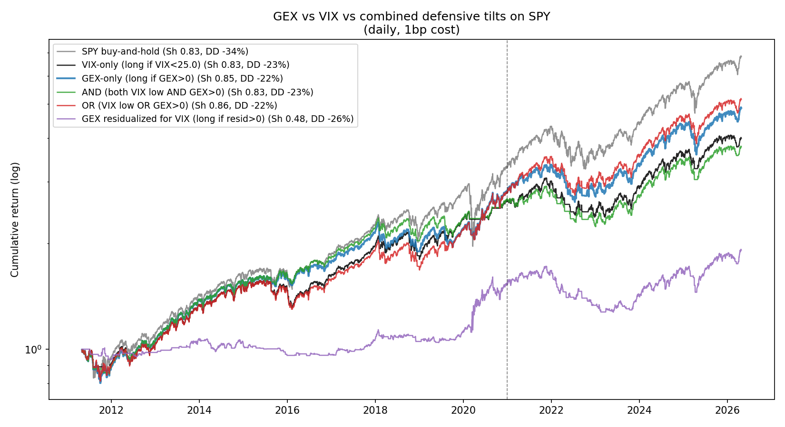

# Dealer Flow vs. Retail Folklore — testing "market makers trap retail" on data

A popular trading claim says market makers steer retail traders into trends and then fade them. This project splits that claim into the mechanisms that are actually documented in the literature, turns each testable one into a signal, and backtests it with out-of-sample splits, transaction costs, and a survivorship-bias control.

**Short answer:** the "fade retail" story is rejected at both the index and the single-stock level. What survives is a simple, low-turnover defensive rule on SPY that uses dealer gamma exposure (GEX) together with VIX.



## Headline results

SPY, daily, 2011-05 → 2026-04 (3,769 trading days). Out-of-sample from 2021-01-01. Round-trip cost 1 bp.

| Strategy | OOS Sharpe | Full Sharpe | Max DD | Turnover / yr |
|---|---:|---:|---:|---:|
| SPY buy-and-hold | 0.90 | 0.83 | −34% | 0 |
| VIX-only (long if VIX < 25) | 0.68 | 0.83 | −23% | 8 |
| GEX-only (long if GEX > 0) | 0.82 | 0.85 | −22% | 14 |
| **Long unless VIX > 25 *and* GEX < 0** | **0.89** | **0.86** | **−22%** | **8** |
| Same rule, 10% vol target | 0.87 | 0.85 | −13% | 11 |

The rule keeps essentially all of buy-and-hold's risk-adjusted return and cuts maximum drawdown by about a third. It steps aside on only ~6% of days.

## What each phase tested

| Phase | Question | Finding | Write-up |
|---|---|---|---|
| 1 | What is real behind the meme? | Three real mechanisms: PFOF/internalization economics, dealer gamma reflexivity, retail attention bias. Only the last two are testable with retail data. | [Theory primer](01_theory_primer.md) |
| 2.1 | Does dealer gamma (GEX) predict SPY? | The intraday "fade in +GEX, ride in −GEX" idea **loses money at daily frequency** (Sharpe −0.49 to −0.72). GEX works as a *stress-regime filter* instead. | [Results](backtest_results.md) |
| 2.2 | Does retail positioning (DIX) mean "fade retail"? | **The opposite.** Higher DIX → higher forward SPY returns, monotone across quintiles (20d Q4–Q1 spread +106 bps, t up to 10.5). Still doesn't beat buy-and-hold as a timing rule. | [Results](backtest_results_dix.md) |
| 2.3 | Do attention-extreme stocks revert (Barber & Odean 2008)? | Rejected: 63-day **continuation**, t = +5.9. | [Results](backtest_results_attention.md) |
| 2.3b | Is 2.3 just survivorship bias from picking 2026 winners? | Re-run on a **2019-vintage** meme basket that includes names that later collapsed: continuation is as strong or stronger (t = +9.4). | [Results](backtest_results_attention_2019vintage.md) |
| 2.4 | Is the short-horizon abnormal-volume fade tradable? | No. Per-trade net return is negative or about zero at every threshold and holding period after 5 bps costs. | [Results](backtest_results_abnvol_fade.md) |
| 2.5 | Is GEX just a noisy VIX? | No. Correlation is only −0.31 (levels). GEX-only beats VIX-only out of sample; requiring both to signal stress is best. | [Results](backtest_results_gex_vs_vix.md) |
| 2.6 | Do continuous position sizes beat the binary rule? | Three-state overfits in-sample; the logistic version gives up too much equity premium; vol-targeting gives the best drawdown. The binary rule stays. | [Results](backtest_results_continuous_rule1.md) |
| 3 | So what for a practitioner? | Operating rules, sizing, and when to override. | [Playbook](04_retail_playbook.md) |

## Repository layout

```
01_theory_primer.md            literature review with citations
02_signals/                    gex.py · dix.py · attention.py — signal construction
03_backtest*.py                one script per phase; each writes its backtest_results_*.md and figures/
daily_signal.py                operational runner for the final rule (prints today's position)
data/raw/                      SqueezeMetrics DIX/GEX history (free public CSV)
figures/                       charts referenced from the write-ups
```

## Reproduce

```bash
pip install -r requirements.txt
python 03_backtest_gex_vs_vix.py     # regenerates backtest_results_gex_vs_vix.md + figures
python daily_signal.py               # today's signal for the final rule
```

Data: [SqueezeMetrics DIX/GEX](https://squeezemetrics.com/monitor/dix) (free CSV) and yfinance daily prices for SPY, VIX and the single-name baskets.

## Limitations

- **The final rule was chosen by comparing variants out of sample** (Phase 2.5 and 2.6 pick the best of six and five variants on 2021+ data). The reported OOS Sharpe is therefore optimistic. A clean test needs a fresh hold-out period, which `daily_signal.py --log` is accumulating.
- GEX comes from one vendor's methodology; the signal depends on how SqueezeMetrics estimates dealer positioning.
- Single-name tests use yfinance. Two 2019-vintage names (NKLA, RIDE) are missing after delisting, so some survivorship bias remains.
- Daily data only. Intraday gamma effects (e.g. Dim, Eraker & Vilkov) cannot be tested here.

Research only, not investment advice.

## License

MIT
